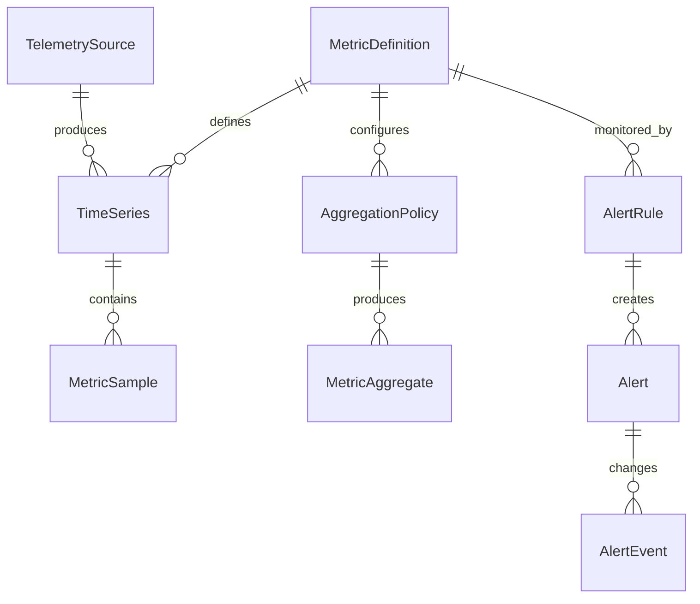

# Доменная модель

Доменная модель описывает понятия и правила предметной области телеметрии.
Она не определяет таблицы, форматы сообщений, способы партиционирования или
конкретные технологии хранения.

Машиночитаемое описание сущностей, полей, перечислений и инвариантов находится
в [`spec/domain.yaml`](../spec/domain.yaml).

## Основные сущности

### TelemetrySource

Наблюдаемый хост, микросервис, приложение или внешний источник. Источник имеет
стабильный внешний идентификатор и предоставляет контекст происхождения метрик.

### MetricDefinition

Определение измеряемого показателя: его имя, тип, единица измерения и допустимые
метки. Оно описывает смысл метрики, но не содержит её значений.

### TimeSeries

Уникальная комбинация определения метрики, источника и набора меток. Все
измерения с одинаковой комбинацией относятся к одному временному ряду.

### MetricSample

Отдельное числовое измерение временного ряда. Содержит время измерения на
источнике и время приёма системой.

### AggregationPolicy

Правило расчёта сводных показателей: функции агрегации, размер временного окна и
метки группировки.

### MetricAggregate

Результат применения политики агрегации к набору измерений за определённое
временное окно.

### AlertRule

Настраиваемое условие обнаружения отклонения. Определяет метрику, фильтры,
оператор сравнения, порог, окно оценки и уровень важности.

### Alert

Текущее состояние срабатывания правила для конкретного источника и набора
меток. Состояние изменяется между `NORMAL`, `PENDING`, `FIRING` и `RESOLVED`.

### AlertEvent

Неизменяемый факт перехода алерта из одного состояния в другое.

### ProcessingFailure

Описание данных, которые не удалось автоматически обработать, включая этап,
причину и число попыток.

### ReplayJob

Управляемое задание на повторную обработку ранее принятых данных за выбранный
диапазон.

## Связи

## Ключевые инварианты

- Временной ряд однозначно определяется метрикой, источником и набором меток.
- Начало временного диапазона всегда предшествует его окончанию.
- Более старое измерение не заменяет последнее известное значение ряда.
- Событие алертинга создаётся только при изменении состояния алерта.
- Неактивное правило не участвует в оценке состояния алертов.
- Завершённое задание повторной обработки содержит время завершения.
